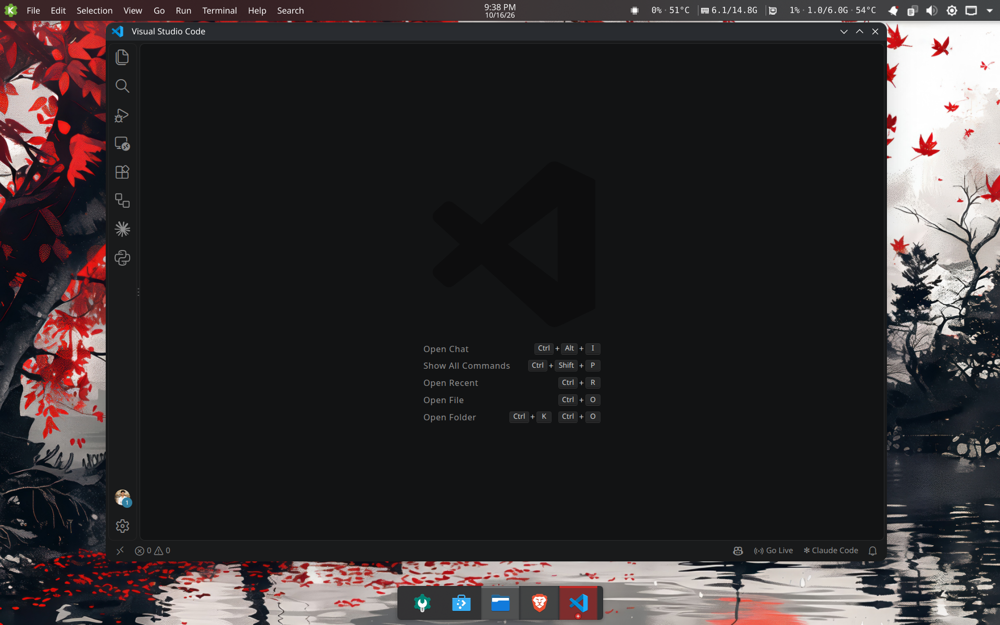

# plasma-setup

My KDE Plasma desktop setup: a top bar and a floating dock, a modern look, kept at Breeze-level performance. This repo records every choice so the setup can be rebuilt from scratch.



Base: Kubuntu 26.04 LTS, Plasma 6.6.6, Wayland, two screens.

## Look

| Part | Choice | Where to set it |
|---|---|---|
| Global theme | Breeze Dark | Colors & Themes > Global Theme |
| Color scheme | Breeze Dark | Colors & Themes > Colors |
| Accent color | `#DA2623` (the main red of the wallpaper) | Colors > Accent color > custom |
| Application style | Darkly | Colors & Themes > Application Style |
| Window decoration | Darkly | Colors & Themes > Window Decorations |
| Plasma style | Breeze | Colors & Themes > Plasma Style |
| Icons | Papirus-Dark | Colors & Themes > Icons |
| Cursor | Breeze, size 30 | Colors & Themes > Cursors |
| Splash screen | None | Colors & Themes > Splash Screen |
| Fonts | Inter 10 (toolbar 9, small 8, window titles 10 Medium), JetBrains Mono 10 fixed | Text & Fonts |
| Animation speed | 0.5x duration | General Behavior |
| Wallpaper | One 4K image, also on lock screen and login screen | Desktop, Screen Locking, Login Screen (SDDM) |

Darkly app style and decoration are compiled C++ like Breeze, so they cost about the same. Keep Darkly's transparency options off or low; those are the only settings with a real GPU cost.

## Panels

Same layout on both screens:

```
Top bar:  [launcher] [app menu] ······ [clock] ······ [pager] [kvitals] | [tray]
Dock:                  ( task manager only )
```

- **Top bar:** 32px, not floating, dodge windows. Launcher, app menu, flexible spacer, clock, flexible spacer, pager, kvitals (CPU usage and temp, RAM, GPU usage, VRAM and temp), margins separator, system tray.
- **Dock:** 52px, floating, centered, fit content, dodge windows, opaque. Task manager only; pin apps with right click > Pin to Task Manager.
- **Notifications:** popups at the top right (`PopupPosition=TopRight`), not center, so they stay in peripheral vision.

Panel config is in `configs/plasma-panels-appletsrc` and `configs/plasmashellrc`. Panel IDs are machine specific, so rebuild the layout in Edit Mode using those files as reference rather than copying them over.

## Packages

Installed:

| Package | Source | Note |
|---|---|---|
| `darkly` 0.5.41 | [Bali10050/Darkly releases](https://github.com/Bali10050/Darkly/releases), `kubuntu-26.04` deb | Manual updates. After a big Plasma or Qt upgrade, install the matching release, or apps fall back to Breeze |
| `papirus-icon-theme` | Ubuntu | |
| `fonts-inter` | Ubuntu | |
| `fonts-jetbrains-mono` | Ubuntu | |

```sh
sudo apt install papirus-icon-theme fonts-inter fonts-jetbrains-mono

curl -LO https://github.com/Bali10050/Darkly/releases/download/v0.5.41/darkly-0.5.41_kubuntu-26.04_amd64.deb
sudo apt install ./darkly-0.5.41_kubuntu-26.04_amd64.deb
```

For a newer Darkly, take the `kubuntu` deb matching your Kubuntu version from the releases page and install it the same way.

## Rebuild order

1. Install the packages above, including the Darkly deb.
2. Global theme Breeze Dark, then set app style and window decoration to Darkly, icons Papirus-Dark, splash None.
3. Fonts from `configs/kdeglobals`. GTK fonts and icons follow from `configs/gtk-3.0-settings.ini`.
4. Accent color `#DA2623`.
5. Put the wallpaper in `~/Pictures/Wallpapers/` (never Downloads, desktop and lock screen point at the file directly). Set it for desktop and lock screen.
6. Login Screen (SDDM): Apply Plasma Settings, then the gear on Breeze to pick the wallpaper. Plasma copies it into the theme, so the login screen keeps it.
7. Panels as described above, notifications top right.
8. VS Code: `configs/vscode-settings.json` (JetBrains Mono with ligatures, native title bar).

## Gotchas

- **App menu widget crashed Brave and VS Code in X11 mode.** Adding the global menu widget makes Plasma load `appmenu-gtk-module` into GTK 3 apps. Chromium and Electron apps launched with `--ozone-platform=x11` segfault on startup with it. Fixed by removing `appmenu-gtk3-module`. Native Wayland launches were never affected.
- **Changing colors can crash running Chromium apps.** Close or restart Brave and VS Code after changing the accent color or color scheme.
- **"Missing theme snaps" notification at login** comes from `snapd-desktop-integration`, not Plasma. Snap apps cannot see apt-installed icon themes. The service is enabled system-wide, so `disable` does not stick; mask it for your user instead: `systemctl --user mask --now snap.snapd-desktop-integration.snapd-desktop-integration.service` (undo with `unmask`).
- **Aurorae decorations need `kwin-style-aurorae`** on Ubuntu, and are QML based, so slower than C++ decorations. This setup does not use Aurorae.
- **Blank strip next to the dock after every login.** With a fit content floating panel, the dock starts wider during login and then shrinks, but the blur area behind it keeps the old size, leaving a blurred strip beside the icons until any window opens. Fix: set the dock's opacity to Opaque in Edit Mode (`panelOpacity=1`), so there is no blur area to go stale.
- **Panel padding does not come from the Plasma style's thick panel margins** for the task manager highlights; editing them made no visible difference.

## Layout of this repo

- `configs/`: extracts of the relevant config groups.
